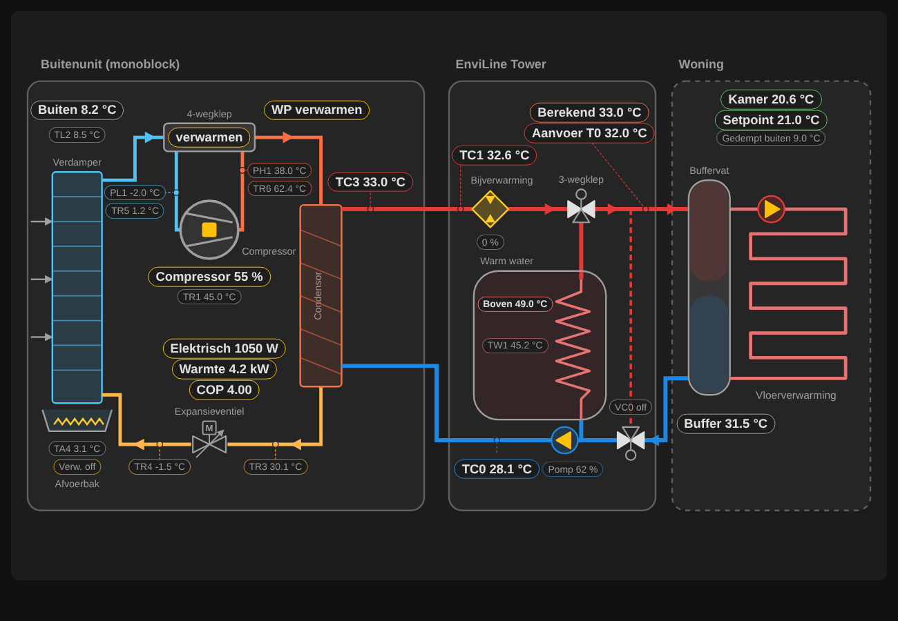
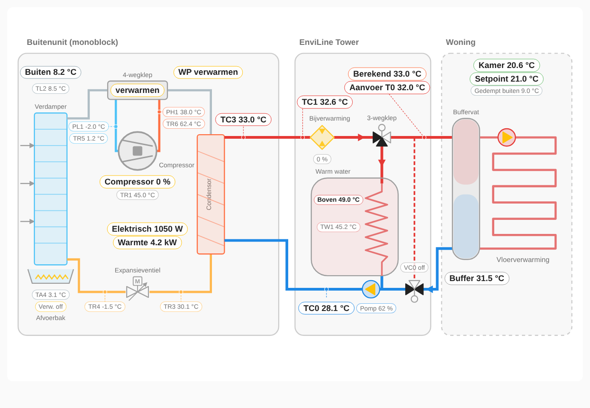

# EnviLine Schema Card

A live Lovelace diagram of a **Nefit-Bosch EnviLine Tower** heat pump (all-electric monobloc outdoor unit), read through **[EMS-ESP](https://emsesp.org)**. It shows the refrigerant circuit, the water side in the Tower (backup heater, 3-way valve, hot-water coil, primary pump, VC0 bypass valve) and the buffer tank with underfloor heating, with every sensor in place.



What moves live:

- Compressor icon turns amber when the compressor runs (`hpcompspd > 0`).
- The 4-way valve lines and refrigerant flow arrows follow heating or cooling (`hp4way`).
- The open ports of the 3-way valve (`ww3wayvalve`) and VC0 (`vc0valve`) are filled in.
- Water flow arrows follow the primary pump, the 3-way valve and VC0.
- Pumps (`heatingpump`, `pc1on`) light up when running.
- Every label and symbol opens the more-info dialog (history) on click.

The card is drawn as inline SVG, so it follows your light or dark theme. Text is available in Dutch and English (follows the HA language by default).



## Installation

### HACS

1. HACS → ⋮ → **Custom repositories** → add `https://github.com/beercpd831/enviline-schema-card` with type **Dashboard**.
2. Install **EnviLine Schema Card** and reload the browser.

### Manual

Copy `dist/enviline-schema-card.js` to `config/www/` and add it as a dashboard resource (`/local/enviline-schema-card.js`, type JavaScript module).

## Configuration

Minimal, with all EMS-ESP entities auto-detected:

```yaml
type: custom:enviline-schema-card
```

Auto-detection looks for entity ids that end in the EMS-ESP short name (`…_hptc3`, `…_hpcompspd`, `…_hc1_currtemp`, …), so it works with any device prefix such as `boiler_` or `ems_esp_boiler_`. Anything it does not find is simply hidden. Override or add entities in the visual editor, or in YAML:

```yaml
type: custom:enviline-schema-card
transparent: true          # no card background
language: nl               # nl or en, default = HA language
refrigerant: R410A         # R410A, R32 or R290: also show PL1/PH1 as pressure in bar
hide: [hpea0, hptr1]       # labels to leave out
entities:
  electric_power: sensor.power_meter_heat_pump   # not from EMS-ESP
  cop: sensor.cop_heat_pump                      # optional, otherwise calculated
  hptc0: sensor.boiler_hptc0
```

| Key | EMS-ESP | Meaning |
| --- | --- | --- |
| `hpcompspd` | boiler | Compressor speed (also drives the animation) |
| `hpactivity` | boiler | Compressor activity |
| `hp4way` | boiler | 4-way valve VR4 (off = heating) |
| `hppl1`, `hptr5` | boiler | Low pressure / suction gas |
| `hpph1`, `hptr6` | boiler | High pressure / discharge gas |
| `superheat_suction`, `superheat_discharge` | – | Optional superheat sensors; if empty the card shows TR5 − PL1 and TR6 − PH1 while the compressor runs |
| `hptr1`, `hptr3`, `hptr4` | boiler | Compressor, liquid side, evaporator inlet |
| `outdoortemp`, `hptl2` | boiler | Outdoor and air inlet temperature |
| `hpta4`, `hpea0` | boiler | Drain pan temperature and heater |
| `hpmode` | thermostat | Heat pump mode (heating / cooling) |
| `hptc3` | boiler | Condenser water outlet (outdoor unit) |
| `hptc1` | boiler | Flow in Tower, before backup heater |
| `hptc0` | boiler | Return to heat pump, after primary pump |
| `curflowtemp` | boiler | T0 flow temperature, top of the buffer tank |
| `targetflowtemp` | thermostat | Calculated flow temperature |
| `heatingpump`, `hpcircspd` | boiler | Primary pump and its speed |
| `ww3wayvalve` | boiler | 3-way valve (on = hot water) |
| `vc0valve` | boiler | VC0 bypass valve (on = bypass) |
| `auxheaterstatus` | boiler | Electric backup heater |
| `headertemp` | boiler | Same sensor as T0; used for the T0 label when `curflowtemp` is missing |
| `pc1on` | boiler | Underfloor heating pump PC1 |
| `wwcurtemp`, `hptw1` | boiler | Hot water top / TW1 |
| `hppower` | boiler | Heat output |
| `electric_power` | – | Electrical power of the heat pump (any W or kW sensor) |
| `cop` | – | COP sensor; if empty it is calculated from `hppower` and `electric_power` while the compressor runs |
| `nrgsupptotal`, `nrgconstotal` | boiler | Lifetime energy supplied / consumed, used for the SCOP fallback |
| `currtemp`, `seltemp`, `dampedoutdoortemp` | thermostat | Room temperature, setpoint, damped outdoor temperature |

### PL1 and PH1 are pressures

EMS-ESP reports the low and high pressure sensors PL1 and PH1 as the saturation temperature that belongs to the measured pressure (evaporating and condensing temperature), not in bar. TR5 and TR6 are the real gas temperatures at the same points, so the difference is the superheat: TR5 − PL1 at the suction side (normally a few K) and TR6 − PH1 at the discharge side. The card shows both, plus a short legend under the outdoor unit.

Set `refrigerant` (see the type plate of the outdoor unit) to also show PL1 and PH1 as absolute pressure in bar. The card converts the saturation temperature with a fit to the refrigerant's saturation table (within 0.5 % from −30 to 60 °C).

## Without a separate power meter

EMS-ESP has no live electrical power for the EnviLine, so `electric_power` has to come from a separate meter (kWh meter, smart plug, P1 sub-meter). Without one, the *Electric* and *COP* labels are hidden and the card shows **SCOP** instead: `nrgsupptotal / nrgconstotal`, the seasonal COP since installation from the EMS-ESP energy counters (backup heater included). The remaining power labels move up so no gap is left.

## Notes

- `hpcompon`, `expvalve` and `recvalve` are not used: on this model they always report off/0.
- The meaning of VC0 "on" as bypass (A→AB) is an assumption; check it against your own installation.
- Sensor positions follow the Bosch EnviLine installation manual (Tower-Solar schema).

## Releases

Bump `CARD_VERSION` in `dist/enviline-schema-card.js`. When that change lands on `main`, the Release workflow tags it (`v0.4.0`, ...) and publishes a GitHub release, so HACS offers it as a versioned update.

## Licence

MIT
