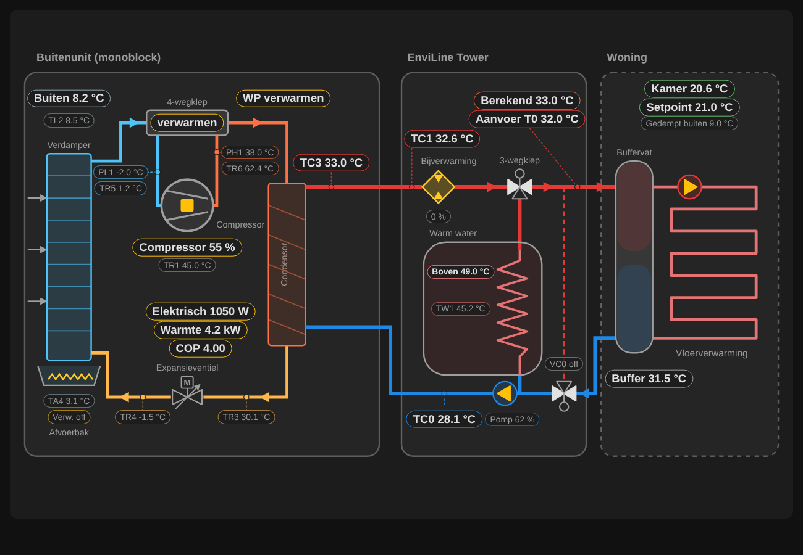
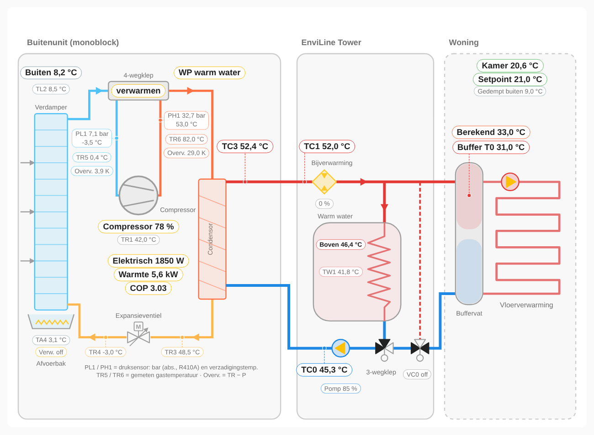

# EnviLine Schema Card

A live Lovelace diagram of a **Nefit-Bosch EnviLine Tower** heat pump (and the **Bosch Compress 5800i AW**, see [Models](#models-and-buffer-tank)) (all-electric monobloc outdoor unit), read through **[EMS-ESP](https://emsesp.org)**. It shows the refrigerant circuit, the water side in the Tower (backup heater, 3-way valve, hot-water coil, primary pump, VC0 bypass valve) and the buffer tank with underfloor heating, with every sensor in place.



What moves live:

- Compressor icon turns amber when the compressor runs (`hpcompspd > 0`).
- The 4-way valve lines and refrigerant flow arrows follow heating or cooling (`hp4way`).
- The open ports of the 3-way valve (`ww3wayvalve`) and VC0 (`vc0valve`) are filled in.
- Water flow arrows follow the primary pump, the 3-way valve and VC0.
- Pumps (`heatingpump`, `pc1on`) light up when running.
- Every label and symbol opens the more-info dialog (history) on click.

The card is drawn as inline SVG, so it follows your light or dark theme. Text is available in Dutch and English (follows the HA language by default).



## Installation

### HACS

1. HACS → ⋮ → **Custom repositories** → add `https://github.com/beercpd831/enviline-schema-card` with type **Dashboard**.
2. Install **EnviLine Schema Card** and reload the browser.

### Manual

Copy `dist/enviline-schema-card.js` to `config/www/` and add it as a dashboard resource (`/local/enviline-schema-card.js`, type JavaScript module).

## Configuration

Minimal, with all EMS-ESP entities auto-detected:

```yaml
type: custom:enviline-schema-card
```

Auto-detection looks for entity ids that end in the EMS-ESP short name (`…_hptc3`, `…_hpcompspd`, `…_hc1_currtemp`, …), so it works with any device prefix such as `boiler_` or `ems_esp_boiler_`. Anything it does not find is simply hidden. Override or add entities in the visual editor, or in YAML:

```yaml
type: custom:enviline-schema-card
transparent: true          # no card background
max_width: 80              # optional: limit the width (in % of the card, or e.g. 900px), centred
language: nl               # nl or en, default = HA language
refrigerant: R410A         # R410A, R32 or R290: also show PL1/PH1 as pressure in bar
hide: [hpea0, hptr1]       # labels to leave out
entities:
  electric_power: sensor.power_meter_heat_pump   # not from EMS-ESP
  cop: sensor.cop_heat_pump                      # optional, otherwise calculated
  hptc0: sensor.boiler_hptc0
```

### Models and buffer tank

```yaml
type: custom:enviline-schema-card
model: compress_5800i      # enviline (default) or compress_5800i
title_indoor: Compress 5800i AW   # optional, overrides the name of the indoor unit
buffer: tee                # 4 (default), tee, series or none
heat_source: flow          # optional: hppower or flow, default from the model
```

`type` is taken by Home Assistant (it names the card), so the option is called `model`. All models share the same diagram; the model sets defaults:

| | `enviline` | `compress_5800i` |
| --- | --- | --- |
| Indoor unit name | EnviLine Tower | Compress 5800i AW indoor unit |
| Default `refrigerant` | – | R290 |
| Heat output | `hppower` | Calculated: PC0 flow × (TC1 − TC0) × 1.163 W per l/h per K |

On the 5800i, `hppower` ("compressor power output") reads about the same as the electrical power, so the card calculates the heat output from the PC0 flow instead. Set `heat_source: hppower` if that turns out to be wrong on your unit.

Sensors that only some models have are shown when they exist: `hpcurrpower` (live compressor power, used as `electric_power` when you have not set your own meter), `pc0flow` (PC0 flow rate) and `fanspd` (outdoor fan speed).

`buffer` picks how the buffer tank is connected:

- `4`: in line, with four connections: heat pump flow in and return out on one side, the heating circuit on the other (Nefit Tower-Solar schema).
- `tee` (or `2`): two connections on T-pieces, the top one on the flow and the bottom one on the return. This is hydraulic separation, like a low-loss header: the primary pump circulates heat pump → flow tee → tank → return tee, and PC1 circulates flow tee → floor → return tee → tank. It is not a short circuit across one pump, but it only works with a second pump (PC1).
- `series`: two connections in series in the return line. All return water flows through the tank; it adds volume (for defrosting) but no separation, and there is often no PC1.
- `none`: no buffer tank.

With `series` and `none` the T0 label sits on the flow pipe.

| Key | EMS-ESP | Meaning |
| --- | --- | --- |
| `hpcompspd` | boiler | Compressor speed (also drives the animation) |
| `hpactivity` | boiler | Compressor activity |
| `hp4way` | boiler | 4-way valve VR4 (off = heating) |
| `hppl1`, `hptr5` | boiler | Low pressure / suction gas |
| `hpph1`, `hptr6` | boiler | High pressure / discharge gas |
| `superheat_suction`, `superheat_discharge` | – | Optional superheat sensors; if empty the card shows TR5 − PL1 and TR6 − PH1 while the compressor runs |
| `hptr1`, `hptr3`, `hptr4` | boiler | Compressor, liquid side, evaporator inlet |
| `outdoortemp`, `hptl2` | boiler | Outdoor and air inlet temperature |
| `hpta4`, `hpea0` | boiler | Drain pan temperature and heater |
| `hpmode` | thermostat | Heat pump mode (heating / cooling) |
| `hptc3` | boiler | Condenser water outlet (outdoor unit) |
| `hptc1` | boiler | Flow in Tower, before backup heater |
| `hptc0` | boiler | Return to heat pump, after primary pump |
| `curflowtemp` | boiler | T0 flow temperature, top of the buffer tank |
| `targetflowtemp` | thermostat | Calculated flow temperature |
| `heatingpump`, `hpcircspd` | boiler | Primary pump and its speed |
| `ww3wayvalve` | boiler | 3-way valve (on = hot water) |
| `vc0valve` | boiler | VC0 bypass valve (on = bypass) |
| `auxheaterstatus` | boiler | Electric backup heater |
| `headertemp` | boiler | Same sensor as T0; used for the T0 label when `curflowtemp` is missing |
| `pc1on` | boiler | Underfloor heating pump PC1 |
| `wwcurtemp`, `hptw1` | boiler | Hot water top / TW1 |
| `hppower` | boiler | Heat output |
| `electric_power` | – / boiler | Electrical power of the heat pump (any W or kW sensor); auto-detects `hpcurrpower` when available |
| `pc0flow` | boiler | Primary pump PC0 flow rate (l/h) |
| `fanspd` | boiler | Outdoor unit fan speed |
| `cop` | – | COP sensor; if empty it is calculated from `hppower` and `electric_power` while the compressor runs |
| `nrgsupptotal`, `nrgconstotal` | boiler | Lifetime energy supplied / consumed, used for the SCOP fallback |
| `currtemp`, `seltemp`, `dampedoutdoortemp` | thermostat | Room temperature, setpoint, damped outdoor temperature |

### PL1 and PH1 are pressures

EMS-ESP reports the low and high pressure sensors PL1 and PH1 as the saturation temperature that belongs to the measured pressure (evaporating and condensing temperature), not in bar. TR5 and TR6 are the real gas temperatures at the same points, so the difference is the superheat: TR5 − PL1 at the suction side (normally a few K) and TR6 − PH1 at the discharge side. The card shows both, plus a short legend under the outdoor unit.

Set `refrigerant` (see the type plate of the outdoor unit) to also show PL1 and PH1 as absolute pressure in bar. The card converts the saturation temperature with a fit to the refrigerant's saturation table (within 0.5 % from −30 to 60 °C).

## Without a separate power meter

EMS-ESP has no live electrical power for the EnviLine (the 5800i has `hpcurrpower`), so `electric_power` has to come from a separate meter (kWh meter, smart plug, P1 sub-meter). Without one, the *Electric* and *COP* labels are hidden and the card shows **SCOP** instead: `nrgsupptotal / nrgconstotal`, the seasonal COP since installation from the EMS-ESP energy counters (backup heater included). The remaining power labels move up so no gap is left.

## Notes

- `hpcompon`, `expvalve` and `recvalve` are not used: on this model they always report off/0.
- The meaning of VC0 "on" as bypass (A→AB) is an assumption; check it against your own installation.
- Sensor positions follow the Bosch EnviLine installation manual (Tower-Solar schema).

## Questions and bugs

Found a bug or have an idea? Open an [issue](https://github.com/beercpd831/enviline-schema-card/issues/new/choose). Please include the card version (browser console, F12), your EMS-ESP version and heat pump model, and a screenshot.

## Releases

Bump `CARD_VERSION` in `dist/enviline-schema-card.js`. When that change lands on `main`, the Release workflow tags it (`v0.4.0`, ...) and publishes a GitHub release, so HACS offers it as a versioned update.

## Licence

MIT
